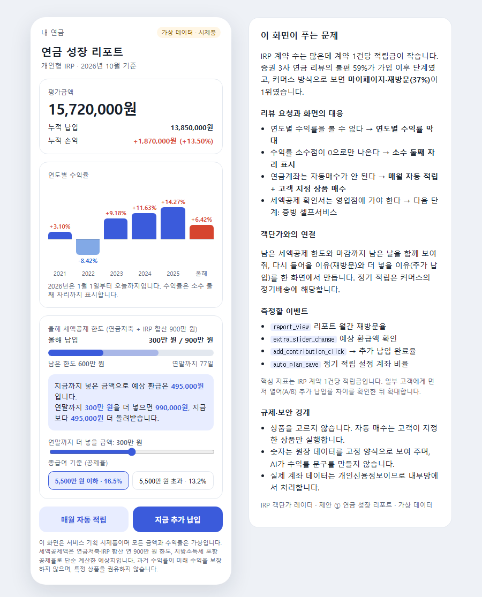

# IRP 객단가 레이더

IRP 가입자는 많은데 계좌는 작은 이유를 **금감원 공시와 앱 리뷰로 찾고**, 고객이 막히는 단계를 디지털 서비스 개선안으로 잇는 분석 프로젝트입니다.

[개선 제안서](docs/proposal.md) | [화면 시제품](https://jhheo51-arch.github.io/irp-aov-radar/prototype/) | [대시보드 이미지](docs/images/dashboard.png) | [Tableau 통합문서](data/tableau/irp_aov_radar.twb) | [대시보드 제작 가이드](docs/tableau-build-guide.md)

## 30초 요약

| 항목 | 내용 |
|---|---|
| 문제 | IRP 계약 수는 증권업권 1위인데 **계약 1건당 적립금은 경쟁사의 42%**다. 고객을 모으는 데는 성공했지만 계좌를 키우지 못하고 있다. |
| 대상 | 연금 앱의 개선 우선순위를 정하는 증권사 디지털 서비스 기획자 |
| 핵심 흐름 | 공시로 격차 확인 → 앱 리뷰로 막히는 단계 찾기 → 이커머스 객단가 방식으로 개선안 → 같은 지표로 다시 재기 |
| 북극성 지표 | **IRP 계약 1건당 적립금** (금감원 공시와 같은 정의라 경쟁사와 분기마다 비교 가능) |
| 현재 상태 | v1 분석 완료(2026-10-15). 분기 공시와 월별 리뷰를 갱신하며 운영하고, 결과에 따라 분류 기준과 개선안을 고도화합니다. **개선안의 실제 효과는 아직 측정 전** |

## 대시보드


- 화면 1: IRP 계약 5만 건 이상 증권사 7곳. 주황 점이 한국투자증권입니다.
- 화면 2: 불편 유형 머리글은 줄임말입니다. 기능 = 기능 부재, 안내 = 정보 부족, 절차 = 절차·서류·대면 요구, 비용 = 수수료·비용.
- 화면 2·3은 증권 3사(한국투자·미래에셋·삼성) 합계입니다.

## 기획 과정: 격차 확인 → 문제 재정의 → 원인 찾기 → 제안 → 운영

### 1. 격차 확인

| 2025년 말 IRP | 계약 수 | 적립금 | 계약 1건당 적립금 |
|---|---:|---:|---:|
| 한국투자증권 | 472,734건 | 7조 4,302억 원 | 약 1,572만 원 |
| 미래에셋증권 | 424,590건 | 15조 8,612억 원 | 약 3,736만 원 |
| 삼성증권 | 338,270건 | 9조 1,298억 원 | 약 2,699만 원 |
| 전 업권 평균 | - | - | 약 1,858만 원 |

출처: 금융감독원 통합연금포털 연금통계(퇴직연금 사업자별 상세).

**격차는 언제 벌어졌나.** 2017~2025년 추이를 보면 두 가지가 보입니다([`irp_trend.csv`](data/processed/irp_trend.csv)).

| 계약 1건당 적립금 (전 업권 평균 대비) | 2017 | 2020 | 2021 | 2025 |
|---|---:|---:|---:|---:|
| 한국투자증권 | 782만 원 (1.48배) | 1,035만 원 (1.26배) | **838만 원 (0.86배)** | **1,572만 원 (0.85배)** |
| 미래에셋증권 | 1,561만 원 (2.96배) | 2,253만 원 (2.74배) | 2,491만 원 (2.55배) | 3,736만 원 (2.01배) |
| 삼성증권 | 3,300만 원 (6.25배) | 3,088만 원 (3.76배) | 1,622만 원 (1.66배) | 2,699만 원 (1.45배) |

1. **2021년에 평균 아래로 내려갔고, 그 뒤로 올라오지 못했습니다.** 2021년 4월 삼성증권을 시작으로 증권사들이 IRP 수수료를 면제하며 계좌 유치 경쟁을 벌였고, 이해 한국투자증권 계약은 7.3만 건에서 16.2만 건으로 늘었습니다. 소액 계좌가 한꺼번에 들어오며 1건당 적립금이 전 업권 평균의 0.86배로 떨어졌고, 2025년에도 0.85배입니다. 같은 시기 계약이 급증한 삼성증권은 1.66배에서 1.45배로 평균 위를 지켰습니다.
2. **지금 새로 늘어나는 계좌도 작습니다.** 2023~2025년 순증 1건당 적립금(추정)은 한국투자증권 평균 약 1,950만 원으로, 미래에셋증권(약 4,840만 원)과 삼성증권(약 4,070만 원)의 40~48%입니다. 예전의 소액 계좌만이 아니라 **지금 들어오는 계좌도 작게 들어와 작게 머무는 구조**입니다.

순증 1건당 적립금은 (올해 적립금 − 작년 적립금) ÷ (올해 계약 수 − 작년 계약 수)입니다. 기존 계좌의 운용수익, 추가 납입, 해지가 섞이므로 실제 신규 계좌 평균과 같지 않으며, 회사 간 같은 방식으로 비교하는 용도로만 씁니다.

### 2. 문제 재정의: 방문자가 아니라 객단가의 문제

방문자(가입자)는 이미 많으니, 이미 들어온 고객의 계좌를 키우는 쪽이 효과가 큽니다. 이커머스가 객단가를 올리는 방식을 연금 여정에 대응시켰습니다.

| 이커머스 | IRP |
|---|---|
| 방문자 수 | 계약 수 |
| 객단가 | 계약 1건당 적립금 |
| 마이페이지·재방문 | 수익률·잔고 조회 |
| 상품 큐레이션 | 상품 선택·운용 |
| 정기배송 | 정기 납입·자동투자 |
| 장바구니 합치기 | 다른 금융사 연금 통합(실물이전) |

### 3. 원인 찾기: 고객은 가입 이후에 멈춘다

증권 3사 앱의 구글 플레이 리뷰 33,667건 중 연금 관련 349건을 **여정 단계 × 불편 유형**으로 분류했습니다.

| 결과 (불편 리뷰 264건) | 값 |
|---|---|
| 가입 이후 단계(수익률·잔고 조회, 상품 선택·운용) | **59%** (156건) |
| 가입·계좌개설 단계 | 19% (51건) |
| 커머스 방식으로 본 1·2위 | 마이페이지·재방문 37%, 상품 큐레이션 29% |
| 한국투자증권 불편 중 오류·장애 | 38% (37건 중 14건, 표본이 작아 참고용) |

### 4. 개선 제안

자세한 내용은 [개선 제안서](docs/proposal.md)에 있습니다.

1. **연금 성장 리포트** (마이페이지·재방문): 연도별 수익률, 올해 남은 세액공제 한도
2. **연금 정기 적립** (정기배송): 연금계좌 자동매수, 고객이 지정한 상품으로 대기자금 운용
3. **비교형 상품 탐색** (상품 큐레이션): 공시 정보 기반 비교까지만. 맞춤 추천은 규제 확인 뒤

**제안 ① 화면 시제품.** [웹에서 바로 열기](https://jhheo51-arch.github.io/irp-aov-radar/prototype/) (가상 데이터, 코드는 [`prototype/index.html`](prototype/index.html)). 평가금액은 한국투자증권 IRP 계약 1건당 평균(약 1,572만 원)에 맞춘 가상 고객입니다.



- 리뷰 요청에 직접 대응합니다: 연도별 수익률, 소수 둘째 자리 수익률, 연금계좌 자동 적립.
- 남은 세액공제 한도와 연말까지 남은 날, 추가 납입 시 예상 환급액(연금저축·IRP 합산 900만 원 한도, 공제율 16.5%/13.2%)을 함께 보여 줘 재방문과 추가 납입의 이유를 만듭니다.
- 자동 매수는 고객이 지정한 상품만 실행하고, 측정할 이벤트(`report_view`, `add_contribution_click`, `auto_plan_save` 등)를 화면 옆 기획 메모에 적었습니다.

### 5. 운영하며 고도화

갱신은 명령 하나로 합니다. 실행할 때마다 수집 → 공식 합계 검증 → 계산 → 대시보드 데이터·통합문서 재생성 → 스냅샷 저장 → 변경 기록이 순서대로 돌고, 한 단계라도 실패하면 스냅샷을 남기지 않고 멈춥니다.

```bash
.venv/Scripts/python scripts/refresh.py              # 공시 갱신 (API 키 불필요)
.venv/Scripts/python scripts/refresh.py --reviews    # 리뷰도 새로 수집·분류 (.env에 ANTHROPIC_API_KEY 필요)
```

- **스냅샷:** [`data/snapshots/<날짜>/`](data/snapshots)에 그날의 핵심 지표(`metrics.json`)와 공개 결과 사본을 남깁니다.
- **변경 기록:** [`docs/data-changelog.md`](docs/data-changelog.md)에 직전 스냅샷과 비교한 표를 맨 위에 추가합니다. 핵심 지표가 좋아졌는지 나빠졌는지 표시하고, 분류 기준(프롬프트 버전)이 바뀌면 리뷰 지표를 그대로 비교할 수 없다고 함께 적습니다.

| 주기 | 할 일 |
|---|---|
| 분기 | `refresh.py` 실행. 사업자별 통계는 연말 기준으로 1년에 한 번 갱신되므로, 새 연도 자료가 나왔는지 확인하고 반영 |
| 월 | `refresh.py --reviews` 실행. 새 리뷰를 같은 기준(`v1`)으로 분류하고 단계별 불편 비중의 변화를 기록 |
| 분류 기준 변경 시 | 버전을 올리고(`v2`) 같은 표본으로 이전 버전과 일치율을 비교한 뒤 적용 |
| 다음 확장 | iOS 앱스토어 리뷰 추가로 한국투자증권 표본 보강, 사람 검수 표본 추가, 시제품으로 사용자 과제 테스트 |

## 판단 기준

- **1인당이 아니라 계약 1건당으로 씁니다.** 공시의 계약 수는 계좌 수이고, 한 사람이 여러 금융사에 IRP를 가질 수 있습니다.
- **공식 합계와 맞을 때만 씁니다.** 수집한 합계를 금감원 화면의 공식 합계와 대조해 0.25% 이내일 때 사용합니다.
- **작은 표본은 결론으로 쓰지 않습니다.** 한국투자증권 리뷰 37건은 3사 비교의 보조 지표로만 씁니다.
- **추천하지 않습니다.** 종목이나 상품을 고르지 않고, 앱 개선 기획을 위한 분석에 머뭅니다.
- **원문과 개인정보는 공개하지 않습니다.** 리뷰 작성자 정보는 수집하지 않고, 리뷰 원문과 근거 인용은 GitHub와 Tableau에 올리지 않습니다. 앱 리뷰가 아닌 개인 글 1건은 분석에서 뺐습니다.
- **고객 데이터를 결합하면 내부망에서 다룹니다.** 실제 계좌 데이터는 개인신용정보가 되므로, 외부 SaaS나 생성형 AI를 쓸 때는 망분리 예외의 범위와 조건을 먼저 확인합니다.

## AI 분류를 이렇게 설계했습니다

- **두 축의 허용값을 고정합니다.** 여정 단계 10개, 불편 유형 8개 안에서만 답하도록 출력 형식을 강제합니다.
- **리뷰 안의 명령은 따르지 않습니다.** 리뷰 본문은 분류 대상일 뿐 지시가 아닙니다.
- **근거 구절을 남기되 공개하지 않습니다.** 판단 근거가 된 원문 구절(40자 이내)은 비공개 파일에만 둡니다.
- **모델과 프롬프트 버전을 기록합니다.** 결과 파일마다 `model`, `prompt_version` 열이 있습니다.
- **다른 검수자가 다시 판정합니다.** 무작위 50건을 별도 AI 검수자가 독립적으로 판정해 여정 단계 96%, 불편 유형 100%가 일치했습니다.

v1 결과는 [`scripts/classify_reviews.py`](scripts/classify_reviews.py)의 프롬프트 `v1`을 Claude Code 세션의 Claude가 적용해 만들었습니다(`model` 열: `claude-code-session`). 같은 기준을 Claude API로 다시 실행하는 경로도 같은 스크립트에 있습니다.

## 확인한 것과 아직 모르는 것

**확인한 것.** 금감원 공시 수집 합계가 공식 합계와 0.25% 이내로 맞습니다. 리뷰 분류는 허용값·누락·중복을 자동 검사하고, 표본 50건 교차 검수를 거쳤습니다. 공개 파일에 리뷰 원문 조각이 없는지 대조했습니다.

**아직 모르는 것.**
- 개선안을 실제로 적용했을 때 계약 1건당 적립금, 추가 납입률이 달라지는지
- 고객 단위(1인당) 적립금, 휴면 계좌 비율, 세액공제 한도 사용률 — 사내 데이터가 있어야 확인 가능
- 사람 검수자가 판정했을 때의 분류 일치율 (지금 검수자는 AI)

**알려진 한계.** 리뷰는 구글 플레이만 수집했고 한국투자증권 연금 리뷰는 37건으로 적습니다. 리뷰 분석은 원인의 단서일 뿐 인과가 아니므로, 제안은 일부 고객에게 먼저 적용해(A/B 테스트) 효과를 확인하는 것을 전제로 합니다.

## 직접 실행하기

```bash
python -m venv .venv
.venv/Scripts/python -m pip install -r requirements.txt
.venv/Scripts/python scripts/refresh.py               # 아래 단계를 한 번에 실행하고 스냅샷·변경 기록 남기기

# 단계별로 실행할 때
.venv/Scripts/python scripts/collect_fss.py           # 금감원 공시 수집과 합계 검증
.venv/Scripts/python scripts/build_aov.py             # 계약 1건당 적립금
.venv/Scripts/python scripts/analyze_trend.py         # 연도별 추이, 순증 1건당 적립금
.venv/Scripts/python scripts/collect_reviews.py       # 구글 플레이 리뷰 (원문은 data/raw/reviews, Git 제외)
.venv/Scripts/python scripts/classify_reviews.py      # .env에 ANTHROPIC_API_KEY 필요
.venv/Scripts/python scripts/summarize_reviews.py
.venv/Scripts/python scripts/build_tableau.py
.venv/Scripts/python scripts/build_twb.py             # Tableau 통합문서 생성
```

## 문서와 코드 안내

| 보고 싶은 것 | 위치 |
|---|---|
| 문제, 근거, 제안 3개, 성공 지표, 보안 전제 | [개선 제안서](docs/proposal.md) |
| 대시보드 구성과 다시 만드는 방법 | [대시보드 제작 가이드](docs/tableau-build-guide.md) |
| 공시 원자료와 계산 결과 | [`data/raw/fss/`](data/raw/fss), [`data/processed/`](data/processed) |
| 갱신 기록과 날짜별 지표 | [`docs/data-changelog.md`](docs/data-changelog.md), [`data/snapshots/`](data/snapshots), [`scripts/refresh.py`](scripts/refresh.py) |
| 격차가 벌어진 시점 (연도별 추이) | [`scripts/analyze_trend.py`](scripts/analyze_trend.py), [`data/processed/irp_trend.csv`](data/processed/irp_trend.csv) |
| 리뷰 분류 결과(원문 제외)와 집계 | [`data/processed/review_labels.csv`](data/processed/review_labels.csv), [`review_heatmap.csv`](data/processed/review_heatmap.csv) |
| 분류 기준 (반복 분류용 에이전트 정의 포함) | [`scripts/classify_reviews.py`](scripts/classify_reviews.py), [`.claude/agents/irp-review-classifier.md`](.claude/agents/irp-review-classifier.md) |

## 제작 방식

제작자가 문제 정의, 지표, 분류 기준, 개선안의 우선순위와 각 단계의 판단을 정했습니다. 코드 작성, 리뷰 분류와 검사는 AI 도구(Claude Code)가 보조했습니다. 공개 저장소에는 공개 통계와 집계·분류 결과만 포함하며, 리뷰 원문, 개인정보와 API 키는 올리지 않습니다.
