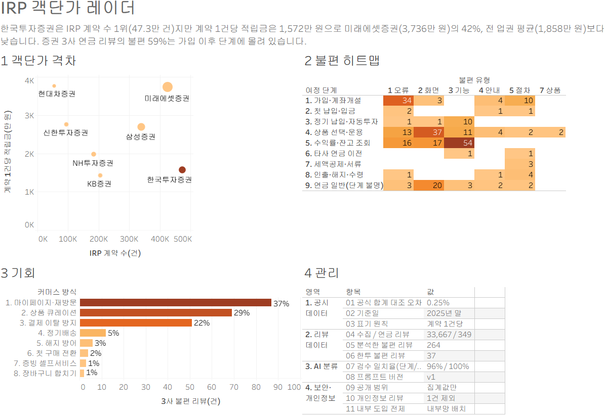

# IRP 객단가 레이더

IRP 가입자는 많은데 계좌는 작은 이유를 공시 데이터와 앱 리뷰로 찾는 디지털 서비스 기획 프로젝트

> 한국투자증권 IT/Digital(AI/디지털/정보보호) 지원 포트폴리오 · 2026년 10월 · 개인 프로젝트

**한눈에 보기**
- **문제:** 한국투자증권은 IRP 계약 수 증권업권 1위지만, 계약 1건당 적립금은 1,572만 원으로 미래에셋증권의 42%입니다.
- **원인:** 증권 3사 연금 리뷰 349건을 AI로 분류한 결과, 불편의 59%가 가입 이후(수익률 조회, 상품 운용) 단계에 몰려 있습니다.
- **제안:** 이커머스의 객단가 공식을 옮긴 [개선 제안서](docs/proposal.md) — 연금 성장 리포트, 연금 정기 적립, 비교형 상품 탐색.
- **원칙:** 공식 합계 대조와 표본 교차 검수로 검증했고, 리뷰 원문과 개인정보는 공개하지 않습니다.

## 대시보드



Tableau로 만들었습니다. 통합문서는 [`data/tableau/irp_aov_radar.twb`](data/tableau/irp_aov_radar.twb)이고, [`scripts/build_twb.py`](scripts/build_twb.py)로 다시 만들 수 있습니다.

- 화면 1: IRP 계약 5만 건 이상 증권사 7곳. 주황 점이 한국투자증권입니다.
- 화면 2: 불편 유형 머리글은 줄임말입니다. 기능 = 기능 부재, 안내 = 정보 부족, 절차 = 절차·서류·대면 요구, 비용 = 수수료·비용.
- 화면 2·3은 증권 3사 합계입니다.

## 출발 질문

한국투자증권은 IRP 계약 수가 증권업권 1위지만, 계약 1건당 적립금은 미래에셋증권의 42% 수준입니다.

| 2025년 말 IRP | 계약 수 | 적립금 | 계약 1건당 적립금 |
|---|---:|---:|---:|
| 한국투자증권 | 472,734건 | 7조 4,302억 원 | 약 1,572만 원 |
| 미래에셋증권 | 424,590건 | 15조 8,612억 원 | 약 3,736만 원 |
| 삼성증권 | 338,270건 | 9조 1,298억 원 | 약 2,699만 원 |

출처: 금융감독원 통합연금포털 연금통계(퇴직연금 사업자별 상세). 계약 수는 계좌 수이며 사람 수가 아닙니다. 한 사람이 여러 금융사에 IRP를 가질 수 있어 '1인당'이 아니라 '계약 1건당'으로 표기합니다.

## 접근 방식

이커머스의 **객단가 키우기**를 연금에 옮겨 봅니다. 방문자(가입자)는 이미 많으니, 고객이 앱의 어느 단계에서 왜 멈추는지 찾아 계좌를 키우는 기능을 제안합니다.

| 이커머스 | IRP |
|---|---|
| 방문자 수 | 계약 수 |
| 객단가 | 계약 1건당 적립금 |
| 정기배송 | 정기 납입 |
| 장바구니 합치기 | 다른 금융사 연금 통합(실물이전) |

## 데이터

| 데이터 | 출처 | 공개 여부 |
|---|---|---|
| 사업자별 적립금·계약 수·IRP 수수료 (2017~2025) | 금감원 통합연금포털 공개 통계 | 공개 |
| 증권 3사 앱 리뷰 (한국투자·미래에셋·삼성) | 구글 플레이 공개 리뷰 | **원문 비공개**, 분류 결과와 집계만 공개 |

수집한 합계는 금감원 화면의 공식 합계와 0.25% 이내로 일치하는지 검증한 뒤 사용합니다.

## 리뷰 분류

연금 관련 리뷰 349건을 **여정 단계(10개) × 불편 유형(8개)** 두 축으로 분류했습니다. 분류 기준은 [`scripts/classify_reviews.py`](scripts/classify_reviews.py)의 프롬프트 `v1`입니다.

- **분류 방법:** 이번 결과는 API 크레딧 없이, 같은 프롬프트 `v1`을 Claude Code 세션의 Claude가 적용해 만들었습니다(결과 파일의 `model` 열: `claude-code-session`). 같은 기준을 Claude API로 재실행하는 스크립트도 함께 두었습니다.
- **품질 확인:** 무작위 표본 50건을 별도 검수자(AI)가 독립적으로 다시 판정한 결과, 여정 단계 96%, 불편 유형 100%가 일치했습니다.
- **개인정보:** 리뷰 1건은 앱 리뷰가 아닌 개인정보가 담긴 글이어서 '연금 무관'으로 처리했습니다. 공개 파일에는 원문과 근거 인용이 없습니다.

| 결과 (불편 리뷰 264건) | 값 |
|---|---|
| 가입 이후 단계(수익률·잔고 조회, 상품 선택·운용) 비중 | 59% (156건) |
| 가입·계좌개설 단계 비중 | 19% (51건) |
| 한국투자증권 불편 리뷰 중 오류·장애 비중 | 38% (37건 중 14건, 표본이 작아 참고용) |

해석: 불편은 가입보다 **가입 이후 계좌를 키우는 단계**에 몰려 있습니다. 한국투자증권 리뷰는 37건으로 적어 회사 단독 결론보다는 3사 비교의 보조 지표로 사용합니다.

## 보안·개인정보 원칙

- 개인정보와 고객 데이터를 쓰지 않습니다. 공개 통계와 공개 리뷰만 사용합니다.
- 리뷰 작성자 이름, 프로필, 리뷰 ID는 수집하지 않으며, 리뷰 원문은 GitHub와 Tableau Public에 올리지 않습니다.
- API 키는 `.env`에만 두고 저장소에 올리지 않습니다.
- 종목이나 상품을 추천하지 않습니다. 앱 개선 기획을 위한 분석입니다.

## 실행 방법

```bash
python -m venv .venv
.venv/Scripts/python -m pip install -r requirements.txt
python scripts/collect_fss.py
python scripts/build_aov.py
.venv/Scripts/python scripts/collect_reviews.py
.venv/Scripts/python scripts/classify_reviews.py        # .env에 ANTHROPIC_API_KEY 필요
.venv/Scripts/python scripts/summarize_reviews.py
.venv/Scripts/python scripts/build_tableau.py
```

## 작업 내역

- [x] 금감원 공시 수집과 합계 검증
- [x] 계약 1건당 적립금 계산
- [x] 앱 리뷰 수집 (전체 33,667건, 연금 관련 349건)
- [x] 리뷰 분류 (여정 단계 × 불편 유형)와 표본 50건 검수
- [x] Tableau용 데이터 4종 ([`data/tableau/`](data/tableau)) 과 [제작 가이드](docs/tableau-build-guide.md)
- [x] Tableau 대시보드 ([이미지](docs/images/dashboard.png), [통합문서](data/tableau/irp_aov_radar.twb))
- [x] [개선 제안서 초안](docs/proposal.md)
